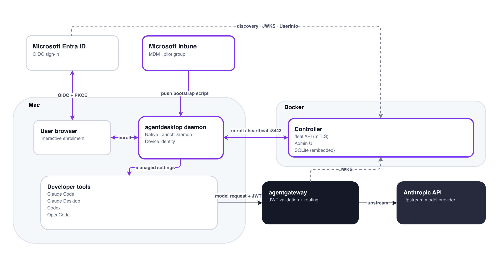
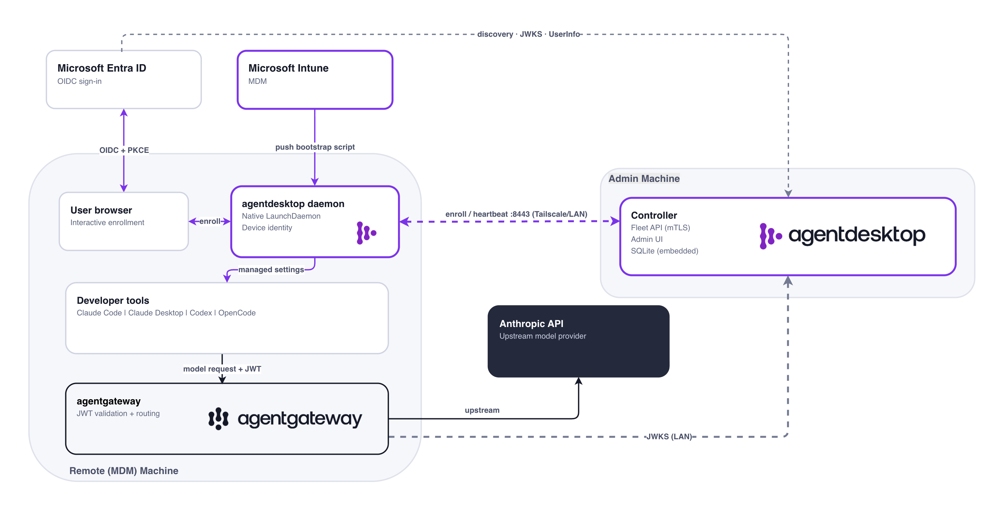

# Agentdesktop Field Kit

[](https://github.com/day0ops/agentdesktop-field-kit/actions/workflows/ci.yml)
[](LICENSE)

A guided wizard to stand up an [agentdesktop](https://agentdesktop.dev) demo on macOS: local Docker-based controller, real Microsoft Entra ID for sign-in, Microsoft Intune managing the pilot Mac.

## Architecture

Single machine (default):



Controller and agentgateway/daemon split across two machines (see "Two-machine setup" below):



## Prerequisites

- macOS (arm64 or amd64)
- [Docker Desktop](https://www.docker.com/products/docker-desktop/), with host networking enabled: Settings > Resources > Network > Enable host networking (required - the controller and agentgateway both bind to `127.0.0.1` inside their containers, which normal `-p` port publishing can't reach)
- [Homebrew](https://brew.sh), then: `brew install azure-cli jq gum`
- `openssl` 3.x
- Microsoft Entra ID + Intune tenant
- [Claude Code](https://docs.claude.com/en/docs/claude-code) and/or [Codex](https://github.com/openai/codex) CLI installed on the pilot Mac, for whichever managed program(s) you select (Codex >= 0.153.4 - agentdesktop's subscription flow is validated against that version; older is a preflight warning, not a hard failure)
- A Claude Team/Enterprise seat and/or a ChatGPT account, for subscription mode - the default for each selected program; you sign in via browser later in the wizard
- `ANTHROPIC_API_KEY` and/or `OPENAI_API_KEY` - optional, only needed if you opt into api-key mode for Claude Code/Codex instead of the default subscription mode. Read only from the environment, never written to disk

## Quick start

```
./run-demo.sh
```

### Advance Installation

Guided, resumable wizard. It remembers which steps are already done (in `state/wizard-progress`) and asks before re-running a completed step or doing anything destructive.

- `./run-demo.sh --from STEP_ID` - jump straight to a step, treating everything before it as already done. Useful for resuming after a break instead of clicking through steps you've already finished. Step ids are the short names the wizard prints as section headers, e.g. `preflight`, `pilot-user`, `entra-app`, `entra-consent`, `intune-licensing`, `managed-programs`, `controller-up`, `agentgateway-up`, `daemon-prepare`, `daemon-enroll`, `intune-groups`, `intune-push`, `intune-enroll`, `validate`.
- `./run-demo.sh --reset` - clear all recorded progress and start over from the first step.

Or run any `scripts/NN-*.sh` standalone - all support `--dry-run` and `--help`.

The `managed-programs` step (`scripts/15-managed-programs.sh`) resolves which of Claude Code / Codex this demo manages and each one's auth mode, and can be driven non-interactively: `--programs claude,codex` (comma-separated subset; default: both, minus whichever preflight found not installed), `--claude-auth-mode` / `--codex-auth-mode` (`subscription` or `api-key`; default per program: `api-key` if that program's API key is already set in the environment, else `subscription`).

agentgateway enforces two per-user limits, keyed on the signed-in user's identity: 20 requests per minute (low on purpose, so you can trip it live) and 300,000 tokens per hour. Both live in memory, so restarting the container resets them: `docker restart agentdesktop-agentgateway`.

## Two-machine setup

Controller and agentgateway/daemon can run on separate machines instead of all on one. 

- On the controller machine: `./run-demo.sh --role controller` 
- On the other machine: `./run-demo.sh --role gateway`

Each `--role` only shows the steps relevant to that machine; shared cloud/Entra/Intune steps run (cheaply, idempotently) on both. The wizard prompts once for the address the other machine uses to reach the controller (LAN IP, Tailscale hostname, etc.) and stores it as `CONTROLLER_PUBLIC_ADDRESS` in `state/demo.env` - every script picks it up automatically from there afterward, or accepts it directly via `--controller-address`.

After `controller-up` finishes, run `scripts/22-export-controller-ca.sh` on the controller machine and follow its printed instructions to copy the (public, non-secret) device CA cert over to the other machine's `state/keys/device-ca.pem` - required before `agentgateway-up`/`daemon-prepare`/`intune-push` will trust the controller over the network.

Managed programs and their auth modes are chosen once, on the controller machine (both programs are offered there, since Claude Code/Codex run on the other machine). The same `22-export-controller-ca.sh` output ends with a `15-managed-programs.sh` command; run it in the other machine's checkout so its agentgateway config matches the daemon config the controller serves. The `--role gateway` wizard waits for that instead of prompting. Any API keys for api-key mode are entered on the other machine, where agentgateway runs.

## What gets created

- **Entra ID**: pilot user, "agentdesktop enrollment" app registration (no secret, PKCE, loopback redirect), admin consent, pilot security group.
- **A second app registration** ("agentdesktop field-kit automation") purely to work around Azure CLI being unable to hold the Intune Graph permission it needs (`AADSTS65002` - Microsoft blocks first-party apps from ad hoc scope grants). Holds a secret only for the seconds it takes to mint a token; deleted immediately after, every run. See `lib/get-graph-app-token.sh`.
- **Local controller**: `docker run` of the published image (SQLite, no Kubernetes/Postgres).
- **Intune**: a shell script (not a signed/notarized PKG - we don't have a notarization identity for a same-day pilot) that installs the daemon as a LaunchDaemon and writes its bootstrap config. That LaunchDaemon runs in system mode, which doesn't support subscription auth, so subscription-mode programs only work through the local `daemon-enroll` path for now; `41-intune-push.sh` warns when this applies.

In subscription mode (the default), once the daemon has enrolled and applied its configuration, the pilot operator signs into Claude.ai and/or ChatGPT in a browser when agentdesktop's checklist/UI prompts for it - a manual step, same as the Entra ID sign-in during enrollment. This isn't needed in api-key mode.

Caution on Codex subscription mode: upstream flags routing a real ChatGPT subscription through agentdesktop/agentgateway as unvalidated against a real paid account beyond its own test fixtures, and whether it complies with OpenAI's terms for production or commercial use is unsettled. Treat it as a demo path only.

## Teardown

```
./scripts/90-teardown.sh                                     # local only
./scripts/90-teardown.sh --include-cloud                     # + Entra/Intune objects
./scripts/90-teardown.sh --include-cloud --wipe-state --yes  # full reset
```